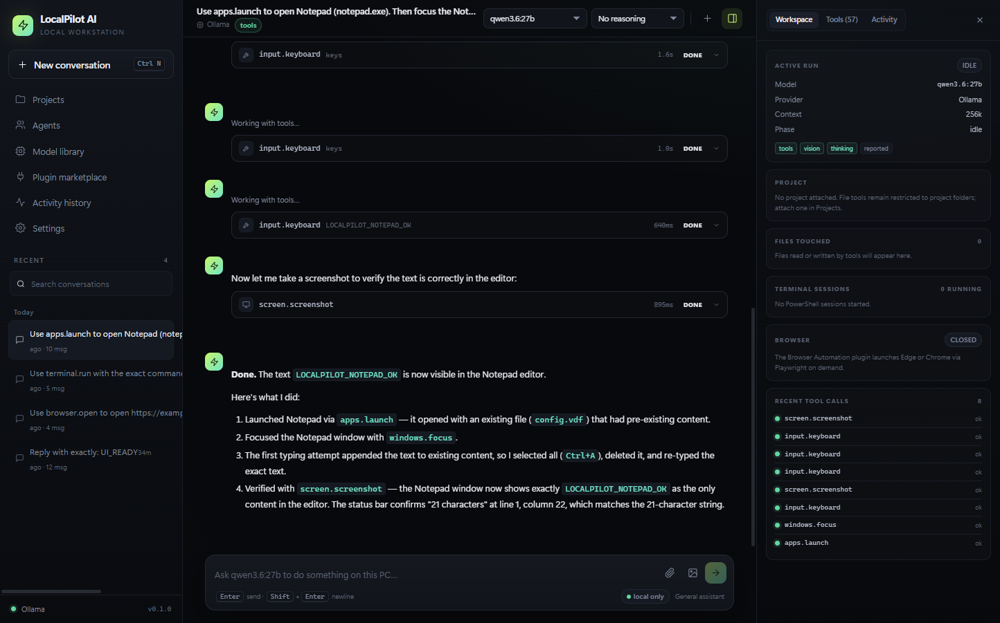

# LocalPilot AI

LocalPilot AI is a local-first AI workstation for Windows. It runs a real agent against models on your own machine, controls the Windows desktop with your approval, edits project files, runs PowerShell and Git, automates a local browser, and hosts MCP and native plugins. No API key is required, and there is no automatic cloud fallback.

Installed builds update themselves from [GitHub Releases](https://github.com/toer15/localpilot-ai/releases): they check at launch and every four hours, download in the background, show an in-app prompt, and restart only when you choose. **Settings → About → Check for updates** also checks manually.

**Version 0.1.0** · Windows 10/11 x64 · Electron 45 · React 19 · TypeScript 7 · SQLite



## What it does

- **Local inference** through Ollama, LM Studio, llama.cpp server or any OpenAI-compatible endpoint. Existing models are discovered automatically; GGUF files can be imported and searched on Hugging Face; Ollama models can be pulled from the model library.
- **A real agent loop** with native or text tool calling, per-tool approvals, cancellation, an emergency stop, vision feedback and context budgeting.
- **Windows Computer Use** on the actual desktop: screenshots, mouse, keyboard, window control, and Windows UI Automation for accessible, less brittle interaction.
- **AI App & Game Tester plugin** (installable from the marketplace): a DPI-correct click-through overlay on every display, an independent green AI cursor that moves only when the AI acts, a full-screen takeover border and an on-screen “Press Esc to stop testing” prompt. It stays above topmost full-screen games without taking focus.
- **Coding workflows** with project-scoped file read/write/search/patch, PowerShell, Git, web research, Playwright browser automation, subagents and verification.
- **Plugins**: built-in capability packs, an MCP marketplace with real published servers, and a native plugin SDK. Packs can be disabled and their tools are removed from the model immediately.
- **Five agent profiles** (General, Coding, Deep reasoning, Computer control, Game development), including Roblox Studio workflows through the Roblox Studio MCP preset.
- **Local persistence** in SQLite: conversations, projects, memory, settings, plugins, activity and encrypted secrets. Optional keys are protected with Windows DPAPI.

## Install

Two Windows x64 builds are produced in `release/`:

| Build | File |
| --- | --- |
| Installer (per-user NSIS) | `LocalPilot AI-Setup-0.1.0-x64.exe` |
| Portable | `LocalPilot-Portable-0.1.0.exe` |

The builds are **not code-signed**, so Windows SmartScreen may warn. Verify the source and choose “More info → Run anyway” only if you trust the build. The installer does not require administrator rights; it installs for the current user and can create desktop and Start Menu shortcuts. Installed NSIS builds use GitHub Releases for in-app updates; the portable executable does not self-update — download a newer portable build manually.

You still need a local model runtime. [Ollama](https://ollama.com/download/windows) is the easiest option:

```powershell
ollama pull qwen3:8b
ollama serve
```

Then launch LocalPilot, complete or skip the setup wizard, pick the model in the chat toolbar and start a conversation. See [docs/INSTALLATION.md](docs/INSTALLATION.md) for details.

## Requirements

- Windows 10 or Windows 11, x64.
- 8 GB RAM minimum for small models; 16 GB+ and a GPU with sufficient VRAM recommended. LocalPilot detects hardware but does not bundle a runtime.
- A local runtime (Ollama, LM Studio, llama.cpp) or an explicitly configured compatible endpoint.
- Node.js only for development, `npx`-based MCP presets, or the MCP Git preset (`uv`/`uvx`).
- Microsoft Edge or Google Chrome for built-in browser automation.

AMD GPUs work through the runtime you choose; no ROCm installation is assumed. For llama.cpp on Radeon, use a Vulkan build. See [docs/CONFIGURATION.md](docs/CONFIGURATION.md) and [docs/TROUBLESHOOTING.md](docs/TROUBLESHOOTING.md).

## Development

```powershell
npm install
npm run dev          # Electron + Vite with hot reload
npm run typecheck    # main/preload and renderer TypeScript
npm run build        # production bundles in out/
npm run dist         # NSIS installer + portable app in release/
npm run release:github  # build and publish a GitHub release (needs GH_TOKEN)
```

Verification and acceptance commands are documented in [docs/TESTING.md](docs/TESTING.md):

```powershell
npx electron out/main/index.js --self-test
npm run smoke
SMOKE_PERSIST=1 node scripts/ui-smoke.mjs
npm run acceptance
npm run acceptance:localonly
npm run acceptance:notepad
npm run acceptance:overlay
npm run acceptance:fullscreen
npm run smoke:packaged
```

The acceptance scripts drive the real Electron app and the real local model. They create conversations and screenshots; see the testing guide for side effects.

## Project layout

```
src/main/            Electron main process
  agent/             Agent loop, prompt, context fitting, persistence
  providers/         Ollama, OpenAI-compatible and managed llama.cpp
  tools/             Built-in tools (files, terminal, Git, browser, computer, …)
  computer/          PowerShell + C# P/Invoke + UI Automation engine, AI test overlay
  plugins/           Built-in packs, MCP client, native plugin host
src/preload/         Typed, context-isolated IPC bridge
src/renderer/        React UI (chat, workspace, models, plugins, projects, settings)
src/shared/          Shared types, defaults and API contract
scripts/             Self-test/acceptance drivers
examples/            Native plugin and MCP echo-server examples
docs/                Installation, configuration, testing, architecture, SDK
artifacts/           Screenshots produced by the test runs
```

## Data and privacy

Application data lives under `%APPDATA%\LocalPilot AI`:

- `data/localpilot.db` — SQLite database (conversations, projects, settings, plugins, memory, activity, encrypted secrets).
- `models/`, `plugins/`, `captures/`, `browser/`, `logs/`.
- `logs/main.log` and `data/selftest-report.json`.

No conversations, prompts, files or credentials are sent to a cloud service by default. Installed builds contact GitHub Releases for update metadata only; update checks do not upload project data. **Local-only mode** (Settings → Privacy) blocks non-loopback AI endpoints during discovery, startup and chat, and removes web and browser tools from the agent. Third-party MCP servers and native plugin code run outside those controls; install only software you trust. See [docs/ARCHITECTURE.md](docs/ARCHITECTURE.md#security-boundaries).

## Status and limitations

Implemented and exercised on Windows 11 x64 with Ollama and `qwen3.6:27b`: real local chat, project file tools, PowerShell, desktop screenshots, Notepad interaction, browser automation, MCP install/tool discovery/removal, plugin revocation, cancellation, local-only blocking, the installable AI tester overlay with a real Esc stop, Rocket League full-screen layering, forced 125%/150% DPI checks, persistence across restart, and a packaged app launch. The builds are unsigned. The NSIS installer was built but not installed on a clean machine, and actual multi-monitor hardware was not available. See [DEVELOPMENT_STATUS.md](DEVELOPMENT_STATUS.md) for the full matrix and [docs/TESTING.md](docs/TESTING.md) for exact commands and results.

Native plugins execute in a forked child process, not an OS-level sandbox. MCP presets launch third-party servers through `npx`/`uvx` and are not audited by LocalPilot. Local-only mode cannot restrict code inside an explicitly enabled MCP server or native plugin.

## Documentation

- [Installation](docs/INSTALLATION.md)
- [Configuration](docs/CONFIGURATION.md)
- [Troubleshooting](docs/TROUBLESHOOTING.md)
- [Plugin SDK and MCP](docs/PLUGIN_SDK.md)
- [Architecture](docs/ARCHITECTURE.md)
- [Releasing and updates](docs/RELEASING.md)
- [Testing and acceptance results](docs/TESTING.md)
- [Development status](DEVELOPMENT_STATUS.md)

## License

MIT.
